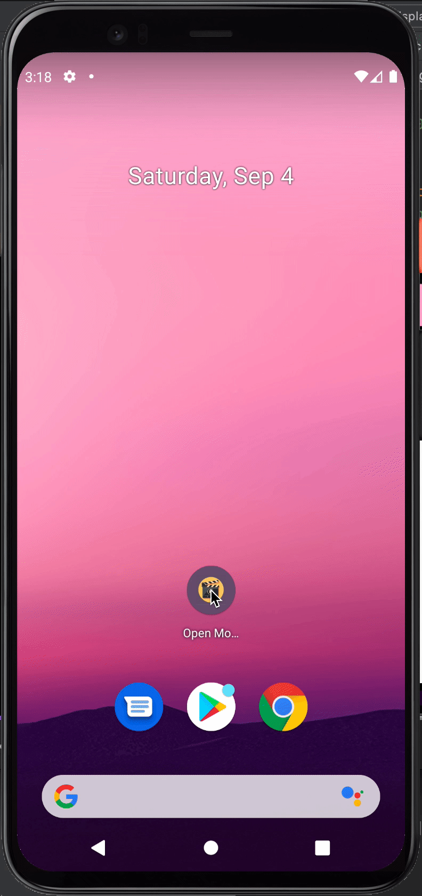
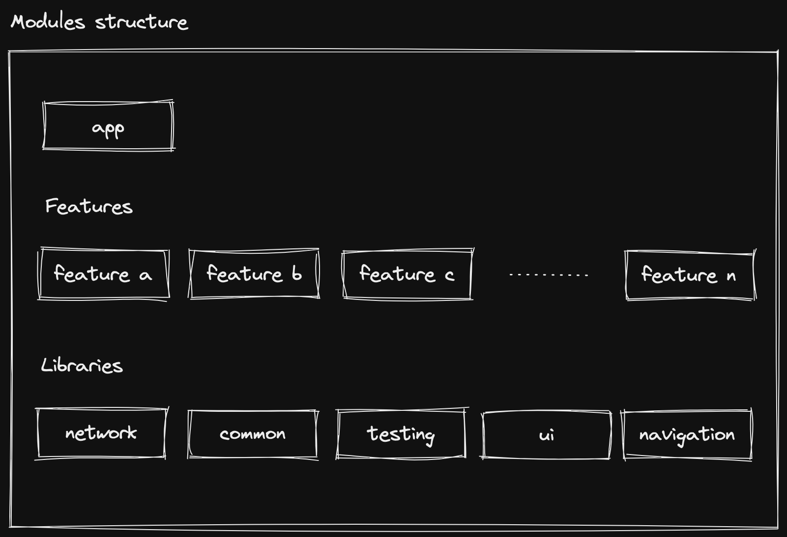
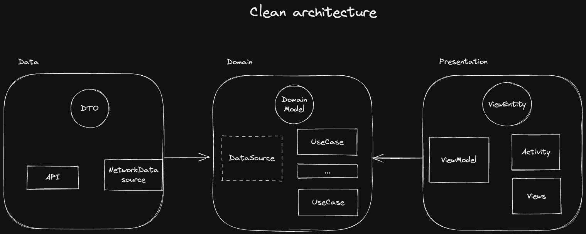
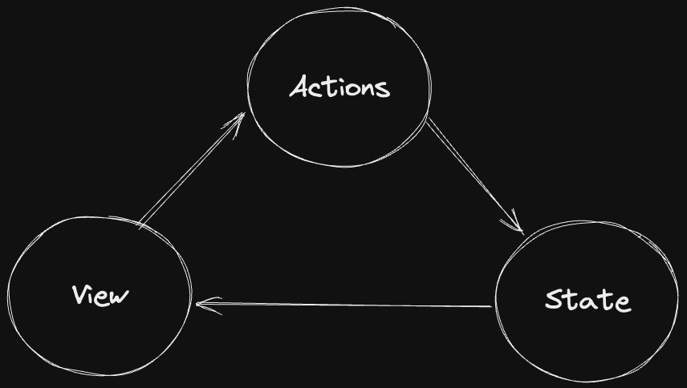

# openMovie
[](https://codeclimate.com/github/horowitz/openMovie/maintainability)

[](https://codecov.io/gh/horowitz/openMovie)

Show case Android practices using [the Movie db](https://www.themoviedb.org/)

&nbsp;&nbsp;&nbsp;&nbsp;&nbsp;&nbsp;&nbsp;&nbsp;  &nbsp;&nbsp;&nbsp;&nbsp;&nbsp;&nbsp;&nbsp;&nbsp; 

## Tech stack
- 100% testable Kotlin code
- Clean Multimodular Architecture
- Presentation layer built based on Unidirectional data flow (UDF) and single entry points
- AGP 9 with built-in Kotlin, JVM 21, and a central Gradle version catalog
- Dagger Hilt
- CI with Github actions
- High test coverage using Unit, Instrumentation and Integration tests

## Architecture

### Multi modular project structure

This project aims for showcasing a multi modular architecture based on 2 concepts: Libraries and Features

- **Features** contains all user facing functionality (e.g. Discover, Movie Details)
- **Libraries** are shared modules that help the building of features (e.g. network,  ui, test)

### Feature architecture

Each feature is developed using clean architecture composed by 3 layers: Data, Domain, and Presentation. 
Domain is completely independent of the other layers and both Data and Presentation depend on Domain.
This inversion of dependencies guarantees scalability, easy maintenance and testability of the code.


#### Feature Presentation Design Pattern
Features are designed following the Unidirectional Data Flow (UDF) principle in conjunction with the Model-View-View-Model pattern

The UDF pattern guarantees predictability of the code which also makes the code much easier to test. These concepts come from the [REDUX](https://redux.js.org/tutorials/essentials/part-1-overview-concepts) framework from javascript

In this project, we use the following structure in order to implement UDF
* The state, the source of truth that drives our feature;
* The view, a declarative description of the UI based on the current state
* The actions, the events that occur in the app based on user input, and trigger updates in the state



We can take the following as an example of UDF:
* State describes the condition of the feature at a specific point in time
* The UI is rendered based on that state
* When something happens (such as a user clicking a button), the state is updated based on what occurred
* The UI re-renders based on the new state


## Building locally

Use an Android Studio version that supports **AGP 9.4.1**, the version pinned in
this project. A successful command-line build does not check IDE compatibility.

Install Android SDK Platform **37**. The build uses a **JDK 21** compiler;
Gradle downloads it automatically if no matching local JDK is available. The
checked-in daemon criteria also select JDK 21 for Gradle itself, so Android
Studio can keep its bundled launcher JDK. Set `sdk.dir` in your
untracked `local.properties`, or set `ANDROID_HOME` to your SDK installation.
Always use the checked-in Gradle wrapper.

```bash
export MOVIE_DB_KEY=your_tmdb_api_key
./gradlew assembleDebug
```

`MOVIE_DB_KEY` is optional for compilation and tests using fake responses; it is
required to load live movies. The app supports Android 8.1 (API 27) and later,
and compiles and targets API 37.

Plugin and library versions live in `gradle/libs.versions.toml`. Compose and
OkHttp dependencies are aligned through their BOMs. Android SDK and JVM settings
are shared in `libraries/common/gradle/android.gradle`.

```bash
./gradlew testDebugUnitTest       # Local unit and network integration tests
./gradlew lintDebug              # Android lint
./gradlew assembleDebugAndroidTest # Compile instrumentation APKs
./gradlew connectedDebugAndroidTest --no-parallel # Run on a connected device/emulator
./gradlew jacocoTestReport       # Unit coverage plus any existing device coverage
```

Coverage reports are written under each app/feature module's
`build/reports/coverage/jacocoTestReport/`. To include device coverage, run
`connectedDebugAndroidTest` before generating the report.

## CI

GitHub Actions uses JDK 21 to build, run unit tests and lint, and compile
instrumentation APKs. A separate emulator matrix runs instrumentation tests on
API 27 and API 37 and uploads coverage and test reports. Codecov uploads use the
repository's `CODECOV_TOKEN` secret.

## Testing strategy

#### *Data Layer*
The data layer is tested through a combination of unit tests + Mockwebserver in order to fully test Retrofit network integrations. By following  this approach we are covering:
-  Retrofit instance
-  Json converters, in this case Kotlin Serialization converters
- Network data sources 

The main idea is to make sure that the whole network integration is working before starting to implement other areas of the application. 

[I've wrote an article explaining how this works in more depth](https://proandroiddev.com/testing-retrofit-converter-with-mock-webserver-50f3e1f54013)


#### *Domain Layer*
For the domain layer the tests are standard unit  tests focusing on outcome not implementation and using the correct test double for each case. Avoiding unecessary mocking of classes is proven to make unit tests faster. There's a good article about when to mock from uncle bob [here](https://blog.cleancoder.com/uncle-bob/2014/05/10/WhenToMock.html)

#### *Presentation Layer*
Finally the presentation layer is tested using the following strategy
- Unit tests for VMs and mappers. Here mocks are used to cover the architectural boundaries (VM and Use cases)
- Instrumentation tests for UI and integration. For those types of tests, the approach used is based [Testing Robots](https://jakewharton.com/testing-robots/)
